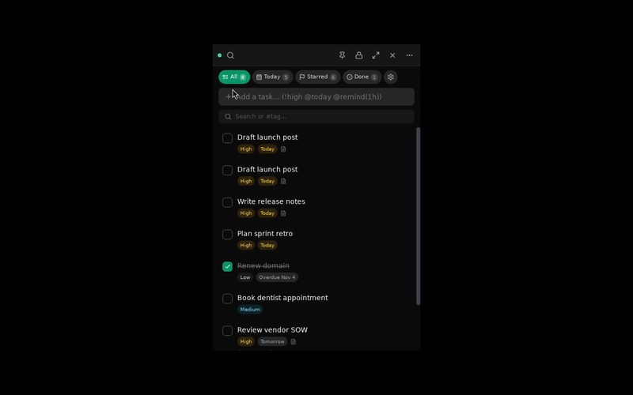
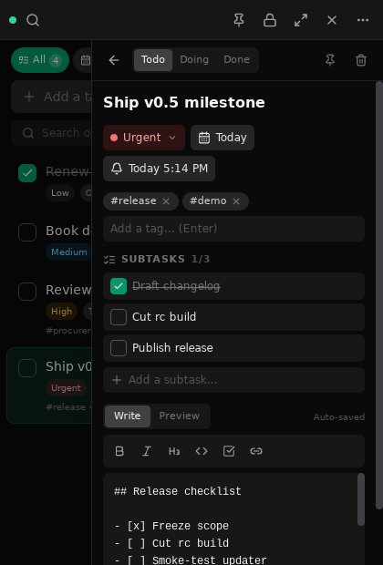
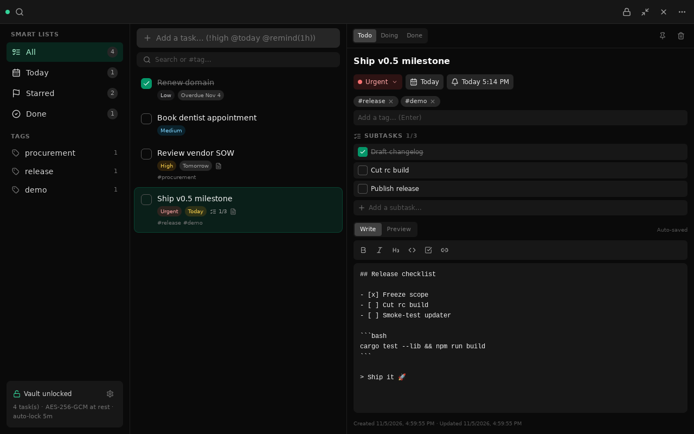
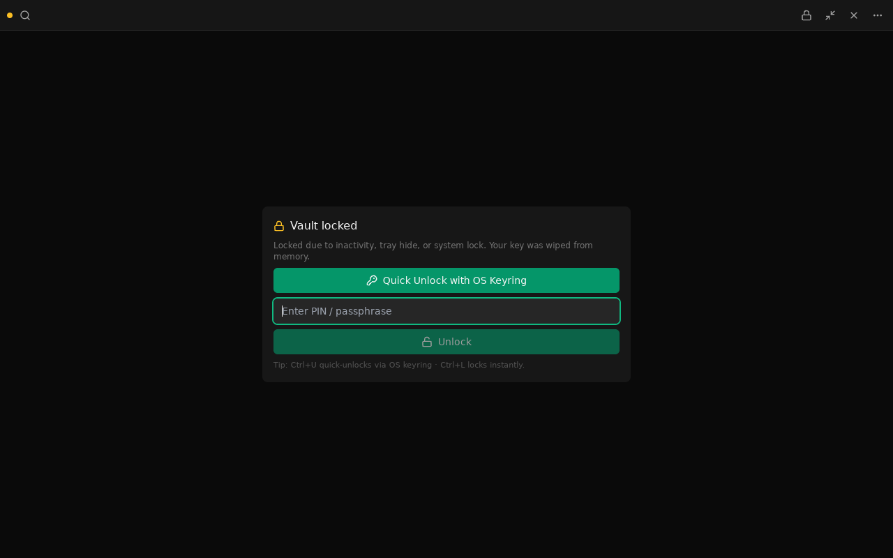
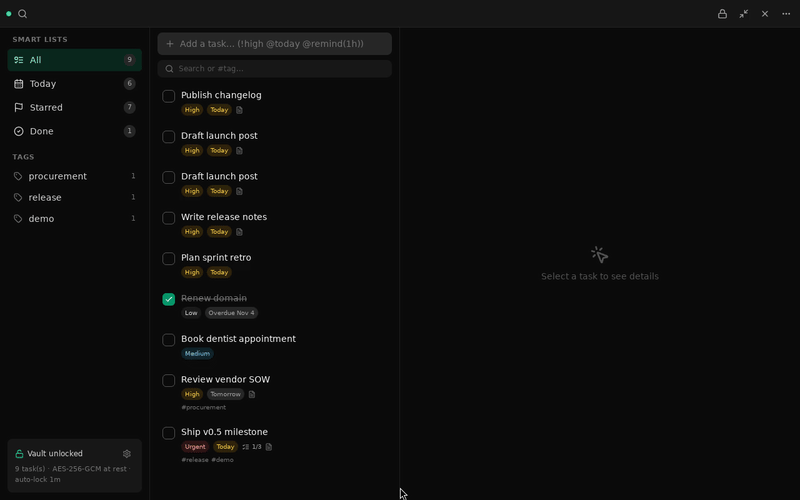

<div align="center">


# VaultTask

**The encrypted task manager that lives in your tray — Rust core, OS webview, zero cloud.**

[](https://github.com/shridhargsabat/vault-task/actions/workflows/ci.yml)
[](https://github.com/shridhargsabat/vault-task/releases/latest)
[](LICENSE)
[](https://v2.tauri.app)
[](https://www.rust-lang.org)
[](https://github.com/shridhargsabat/vault-task/releases/latest)

</div>



| Tray flyout + drawer | Maximized workspace | Lock screen |
|---|---|---|
|  |  |  |



## Why VaultTask?

| | VaultTask | Typical Electron task app |
|---|---|---|
| Idle footprint | ≈170 MB, one native process (measured, Linux release build) | 300–500 MB+ across helper processes |
| Installer download | ~5–6 MB (`.msi` / `.rpm`) | 80–150 MB (bundled Chromium) |
| Rendering | OS webview (WebView2 / WebKitGTK) | Ships its own Chromium per app |
| Encryption | Argon2id + AES-256-GCM, local only | Often cloud-synced plaintext |
| Idle behavior | Auto-locks, zeroizes keys from RAM | Stays unlocked indefinitely |
| Updates | In-app, signature-verified | Store-only or manual downloads |

Hit `Ctrl+Shift+Space` anywhere: a 420×620 flyout drops from your tray
with quick-add (`!high @today @remind(1h)`), filters, and encrypted
Markdown notes. Need room? One click expands to a full 3-column
workspace. Walk away and the 1-second Rust watchdog locks the vault and
wipes keys from memory — D-Bus session lock included on Linux.

## Download & install

Grab the latest release for your OS (verify with
[`SHA256SUMS.txt`](https://github.com/shridhargsabat/vault-task/releases/latest/download/SHA256SUMS.txt) —
every asset is minisign-signed and the app re-verifies before installing):

| OS | Format | Install |
|---|---|---|
| Windows 11 | [`.msi`](https://github.com/shridhargsabat/vault-task/releases/latest/download/VaultTask_0.4.4_x64_en-US.msi) ✅ | Download → double-click (assisted in-app updates) |
| Windows 11 | [`-setup.exe`](https://github.com/shridhargsabat/vault-task/releases/latest/download/VaultTask_0.4.4_x64-setup.exe) ✅ (NSIS) | Full updater support with silent auto-updates |
| Ubuntu 24.04+ | [`.deb`](https://github.com/shridhargsabat/vault-task/releases/latest/download/VaultTask_0.4.4_amd64.deb) ✅ | `sudo apt install -y ./VaultTask-*.deb` (self-updates via PackageKit) |
| Ubuntu 24.04+ | [`.AppImage`](https://github.com/shridhargsabat/vault-task/releases/latest/download/VaultTask_0.4.4_amd64.AppImage) ✅ | `chmod +x` → run (needs `libfuse2`; full updater support) |
| Fedora 41+ | [`.rpm`](https://github.com/shridhargsabat/vault-task/releases/latest/download/VaultTask-0.4.4-1.x86_64.rpm) ✅ | `sudo dnf install -y ./VaultTask-*.rpm` (self-updates via PackageKit) |

```bash
# Verify any download (Linux):
sha256sum -c SHA256SUMS.txt --ignore-missing
```

**In-app updates, per install kind:** NSIS/AppImage via the signed
`latest.json` plugin flow · rpm/deb via PackageKit (`pkcon
install-local`, native password prompt, no terminal) · MSI assisted
(verified download, then the MSI wizard). Package downloads survive slow
links (10-minute budget) and every byte is minisign-verified before
anything executes. GNOME users: enable
`gnome-extensions enable appindicatorsupport@rgcjonas.gmail.com`, then
log out/in once.

## Shortcuts & quick-add

| Shortcut | Action |
|---|---|
| `Ctrl+Shift+Space` | Summon / hide the tray flyout from anywhere |
| `Ctrl+L` | Lock the vault instantly |
| `Ctrl+U` | Quick-unlock via OS keyring (falls back to PIN) |
| `Escape` | Close dialog / drawer |

| Quick-add token | Effect |
|---|---|
| `!urgent` `!high` `!med` `!low` (or `!4`–`!1`) | Set priority |
| `@today` `@tomorrow` `@2026-12-01` | Set due date |
| `@remind(15m)` `@remind(1h)` `@remind(tomorrow)` `@remind(17:30)` | Schedule a native OS reminder |
| `#tag` | Tag the task (filterable) |

Example: `Ship v0.5 !urgent @today @remind(1h) #release`

Reminders fire as native OS toasts — but a locked vault (or hidden
previews) only ever shows a generic *"VaultTask Reminder"*. Titles
decrypt in memory solely when unlocked with previews allowed.

## Security architecture

- **At rest:** every sensitive field is AES-256-GCM ciphertext in a local
  SQLite store; keys derive from your passphrase via Argon2id
  (`m=65536, t=3, p=4`). No account, no cloud, no telemetry.
- **In memory:** the `MasterKey` zeroizes on lock; idle timeout (30s–1h),
  session lock, and hide-to-tray all funnel through one lock path.
- **Quick-unlock (optional):** derived key in Windows Credential Manager /
  Secret Service, verified against the vault verifier before use.
- **Backups:** signed `.vault` bundles (SHA-256 integrity, atomic
  password-verified restore) + unlocked-only Markdown export.
- **Supply chain:** strict branch protection, 4-gate CI (fmt/clippy/
  tests/typecheck/Windows/deny), signed manifests, `SHA256SUMS.txt`.

Full build history lives in [CHANGELOG.md](CHANGELOG.md) — every phase,
every E2E proof, every benchmark.

## Building from source

Prereqs everywhere: Rust stable via rustup + Node 20+.

```bash
# Ubuntu 24.04+
sudo apt install -y libwebkit2gtk-4.1-dev libayatana-appindicator3-dev \
  librsvg2-dev libssl-dev build-essential curl
# Fedora 41+
sudo dnf install -y webkit2gtk4.1-devel libappindicator-gtk3-devel \
  librsvg2-devel openssl-devel
# Windows 11: WebView2 (pre-installed) + WiX 3.11+ for MSI / NSIS for .exe
```

```bash
npm install
npm run tauri dev        # develop
npm run typecheck && npm run build && cd src-tauri && cargo test  # verify
npm run tauri build -- --bundles msi nsis   # Windows
npm run tauri build -- --bundles deb appimage  # Ubuntu (AppImage needs libfuse2)
npm run tauri build -- --bundles rpm appimage  # Fedora
```

Headless testing needs a session bus:
`dbus-daemon --session --fork --print-address` exported as
`DBUS_SESSION_BUS_ADDRESS`.

---

MIT OR Apache-2.0 · [Releases](https://github.com/shridhargsabat/vault-task/releases) · [Changelog](CHANGELOG.md)
